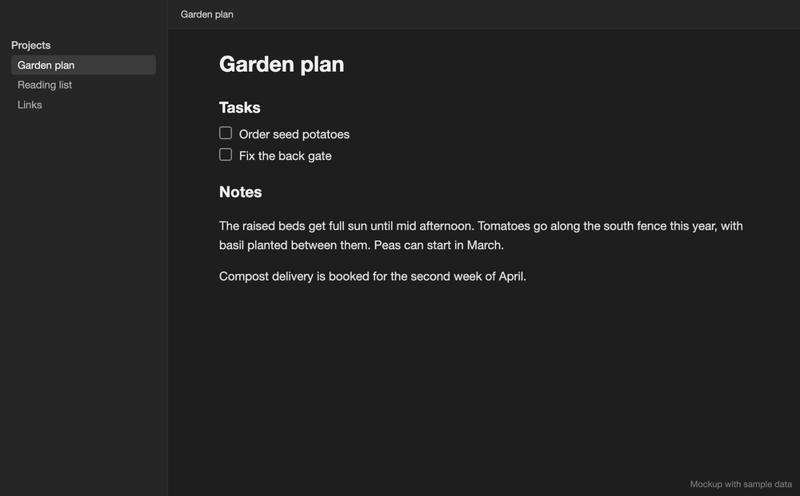

# Better Editor

Better Editor puts writing and workspace tools in one Obsidian plugin. Each feature has its own switch in **Settings → Better Editor**, and turning one off also removes its commands and automatic behavior.



*Mockup with sample data.*

## Features

### Website link filing

**Better Editor: Move standalone website links to Links list** moves lone `http://` and `https://` links under a `[[Links]]` list. It leaves paragraph links, task links, images, inline code, and fenced code alone.

### Note organizer

**Better Editor: Organize current note** can be run at any time, even when automatic organization is off. Manual and automatic organization each have their own settings:

| Setting | Choices / behavior |
| --- | --- |
| Empty lines | Remove all, collapse repeated blank lines to one, or keep all |
| Keep blank line after top heading | Keep one existing blank line after the first heading, even with Remove all selected; on by default |
| Move website links to Links | File standalone website links under the Links list |
| Group tasks at top of non-daily notes | Gather top-level tasks and their children before any heading, after YAML properties; on by default |
| Move tasks to Tasks | Move top-level tasks and their children under the first Tasks or To-do heading |
| Move free text to Notes | Move simple text lines and list items under the first Notes heading |
| Add bullets to text | Add bullets whether text moves or stays in place |

Turning off **Website link filing** also disables link filing in both organizer modes. In non-daily notes, **Group tasks at top of non-daily notes** takes priority over **Move tasks to Tasks**: it gathers tasks from all sections and doesn't create a heading. Daily notes keep their existing task filing, and are identified by the enabled Daily notes core plugin's folder and date format.

With grouping off, tasks only move if a Tasks or To-do heading already exists, and notes only move if a Notes heading exists. Neither heading is created for you. Bullet formatting has its own switch, so turning off movement leaves it on. Nested tasks stay with their parents, and task blocks containing protected literal content stay in place.

**Organize notes when opened** turns on the automatic profile, and **Only daily notes** limits it to the Daily notes core plugin's folder and date format. Feature switches sit beside their related settings. A disabled feature keeps its saved options.

The organizer doesn't touch YAML frontmatter, fenced code (including longer fences), HTML comments, display math, headings, link definitions, or compound list blocks. Links nested under another item or with indented children stay where they are. Empty-line cleanup skips protected literal blocks. You can undo an organize like any other edit.

### Smart selection

**Better Editor: Expand selection by paragraph, section, then note** grows the selection in three steps:

1. Select the current paragraph without its list or task marker.
2. Select the text below the current heading and above the next heading.
3. Select the whole note except its first top-level `#` heading.

### Task marker deletion

Backspace or Delete removes a task marker such as `- [ ] ` or `- [x] ` as one unit, including with multiple cursors.

### Mini toolbar

On desktop, selecting text brings up a floating toolbar with cut, copy, bold, italic, strikethrough, and underline.

In settings, you can change the Copy, Strikethrough, and Underline buttons to Heading 2, Heading 3, or Heading 4. A heading action replaces any existing heading marker. The toolbar and saved styling also work in Journal View editors, but not in small embedded editors such as table cells.

Underlines, and any colors or highlights saved in earlier releases, are stored in Better Editor's local plugin data, not in the Markdown. They stay readable, but you can't set new colors. They won't appear in other Markdown apps, and they're hidden while the Mini toolbar feature is off.

### Tab bar controls

The desktop-only **Better Editor: Hide/show tab bar** command toggles the main tab bar in the current window. The editor fills the freed space, and a configurable gradient sits behind the window controls. The tab bar can also hide automatically in any window with only one main tab open.

### Linked file deletion

**Better Editor: Delete current file and clean linked mentions** tells you how many linked mentions will change and asks you to confirm. It then updates links to the file in other Markdown notes and moves the file to your configured trash location. In settings, choose either:

- **Keep their display text** to turn wiki links and Markdown links into unlinked text
- **Remove them completely** to remove only the matching link tokens

Every edit is prepared and validated before a linked note changes. Deletion stops if a note changes partway through or a mention can't be located safely. If moving the file to trash fails, completed link edits are restored when that's safe.

## Installation

### BRAT

1. Install BRAT in Obsidian.
2. Add `turnipsforme/better-editor` as a beta plugin.
3. Enable **Better Editor** in **Settings → Community plugins**.

### Manual

Copy `main.js`, `manifest.json`, and `styles.css` into:

```text
<vault>/.obsidian/plugins/better-editor/
```

Then reload Obsidian and enable **Better Editor**.

## Latest release: 1.5.0

Fixes **Delete current file and clean linked mentions**. The command deleted the note before cleaning up links, so links in other notes stayed in place and an error appeared. It now asks for confirmation in its own dialog, updates every linked mention first, and only then moves the file to the trash. Because it no longer uses Obsidian's built-in deletion prompt, the command always asks for confirmation and doesn't offer to delete unlinked attachments.

### 1.4.0

Adds **Keep blank line after top heading** and **Group tasks at top of non-daily notes** to both manual and automatic organization settings. Both are on by default. Tasks in non-daily notes are gathered before any heading, after properties, while daily notes keep their existing task-filing behavior. The spacing option keeps an existing blank line after the first heading even when other empty lines are removed.

### 1.3.1

Fixes the Obsidian review findings by using its supported style helper for toolbar positioning and making the cut and copy button callbacks return synchronously. Clipboard actions still run asynchronously and keep their existing failure handling.

### 1.3.0

Removes the color picker, its menus, color-setting actions, and unused menu styles. The six remaining toolbar buttons have clear labels and focus indicators, retain the selection when clicked, and update immediately when their heading options change. Positioning handles rapid updates, right-to-left selections, existing selections on startup, and closed toolbars. Escape dismisses the toolbar; opening and closing stay instant.

Existing saved formatting remains readable. See [the audit notes](AUDIT.md) for the Emil-based toolbar review, validation, and remaining limitations.

## Development

```sh
npm install
npm test
npm run build
```

## Privacy

Better Editor works locally. It does not require an account, make network requests, use telemetry, or access files outside your Obsidian vault.

## Credits

The mini toolbar is based on [xRyul's Mini Toolbar V2](https://github.com/xRyul/obsidian-mini-toolbar-v2), which builds on [Quorafind's Mini Toolbar](https://github.com/Quorafind/Obsidian-Mini-Toolbar). See [THIRD_PARTY_NOTICES.md](THIRD_PARTY_NOTICES.md) for its license notice.

## License

Better Editor is released under the MIT License. See [LICENSE](LICENSE).
